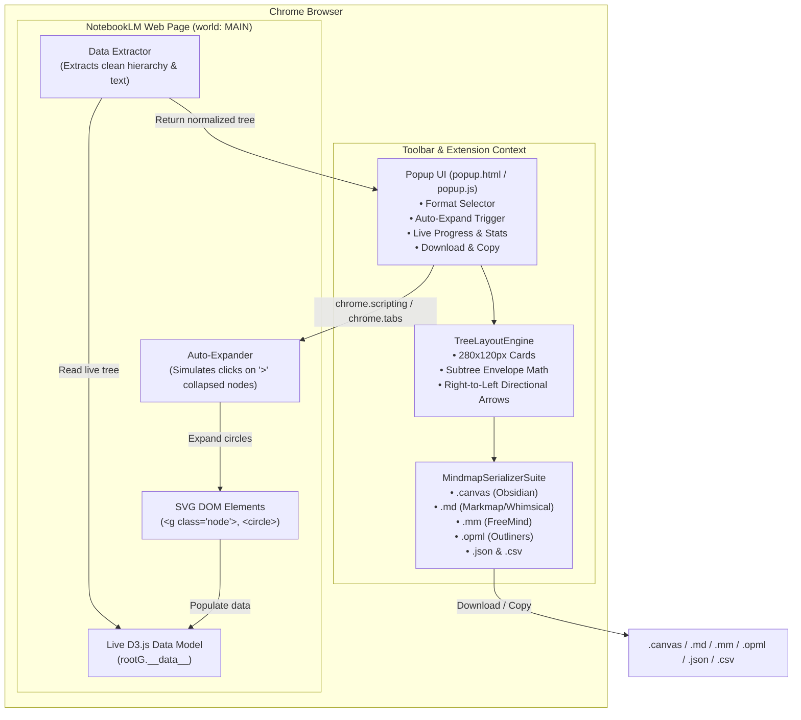

# Multi-Phase Implementation Plan: Google NotebookLM Mindmap Extractor (Chrome Extension MV3)

This plan translates the specifications in [PRD.md](PRD.md) into concrete, sequential, and testable phases of work.

---

## 🗺️ Architectural Overview



---

## 📅 Multi-Phase Roadmap

### Phase 1: Extension Foundation & Manifest V3 Restructuring
**Objective:** Clean up the legacy Chrome extension structure, establish a modern Manifest V3 configuration, and ensure full domain and permission compatibility.

- [x] **Task 1.1: Manifest V3 Configuration (`manifest.json`)**
  - Update `manifest_version` to 3.
  - Set extension metadata: name ("NotebookLM Mindmap Extractor to Obsidian Canvas"), clean description, and version `2.0.0`.
  - Configure `host_permissions` for both domains:
    - `https://notebooklm.google.com/*`
    - `https://notebook.google.com/*`
  - Request minimal necessary permissions: `activeTab`, `scripting`, `downloads`, `clipboardWrite`, `storage`.
  - Configure standard action popup referencing `popup.html` and extension icons (`icon16.png`, `icon32.png`, `icon48.png`, `icon128.png`).
  - Configure background service worker (`background.js`).
- [x] **Task 1.2: Directory & Modular File Organization**
  - Create dedicated modular folders or files:
    - `scripts/extractor.js` (Main-world script for DOM & D3 extraction)
    - `scripts/layout.js` (Pure TreeLayoutEngine calculation module)
    - `scripts/serializer.js` (Multi-format export serializers)
    - `popup/` or root `popup.html` and `popup.js` (Refactored modern UI)
  - Ensure all web-accessible or injectable scripts are properly registered in `manifest.json`.

---

### Phase 2: In-Page Auto-Expansion & D3 Memory Extractor
**Objective:** Implement the core extraction engine that runs in the page's MAIN execution world, interacts with live D3 data, and automatically expands collapsed branches.

- [x] **Task 2.1: Auto-Expansion Engine**
  - Scan for active mindmap SVG container and `g.node` elements.
  - Locate collapsed node indicators (`text.expand-symbol` containing `>` or `aria-expanded="false"`).
  - Find the clickable companion `<circle>` element for each collapsed node.
  - Sequentially dispatch synthetic `mousedown`, `mouseup`, and `click` mouse events with small frame delays (50ms) to trigger NotebookLM's native expand handlers.
  - Loop with a safety limit (max 50 iterations) until no collapsed symbols remain, ensuring 100% of the hierarchy is rendered.
- [x] **Task 2.2: D3 Memory Binding Parser (`__data__`)**
  - Locate `rootG = svg.querySelector('g.node')` and verify existence of `rootG.__data__`.
  - If a child node is returned, traverse upward via `.parent` until reaching the top-level root node.
  - Implement recursive tree normalization function:
    - Extract node text from `node.data?.name`, `node.name`, or `node.text`.
    - Check both `node.children` and `node._children` (D3 collapsed cache).
    - Track visited node IDs using a `Set` to prevent infinite recursion and circular references.
    - Standardize normalized node shape:
      ```json
      {
        "id": "node-1",
        "text": "Concept Name",
        "depth": 0,
        "children": []
      }
      ```
  - Package execution as an injectable function or main-world script via `chrome.scripting.executeScript({ target: { tabId }, world: 'MAIN', func: ... })`.

---

### Phase 3: Collision-Free Tree Layout Engine (Obsidian Canvas)
**Objective:** Port and refine the deterministic 2D layout calculation engine that arranges mindmap nodes onto an auto-spaced visual canvas.

- [x] **Task 3.1: Dimensions & Spacing Metrics**
  - Standard card dimensions: `Width = 280px`, `Height = 120px`.
  - Horizontal level gap: `100px`.
  - Vertical sibling gap: `40px`.
- [x] **Task 3.2: Recursive Vertical Subtree Envelope Calculation**
  - Calculate total subtree bounding heights recursively from leaf nodes up to root.
  - Assign non-overlapping vertical offsets (`y`) so wide branches never overlap sibling subtrees.
  - Center parent cards vertically relative to their collective children bounds.
- [x] **Task 3.3: Directional Edge Routing**
  - Generate edges linking parent cards to children.
  - Fix anchor attachments:
    - `fromSide: "right"` (right-middle of parent card)
    - `toSide: "left"` (left-middle of child card)
    - `toEnd: "arrow"` (clear directional indicator)

---

### Phase 4: Mindmap Serializer Suite
**Objective:** Build isolated, modular serializers for Obsidian Canvas, Markdown/Markmap, FreeMind, OPML, JSON, and CSV.

- [x] **Task 4.1: Obsidian Canvas Serializer (`toObsidianCanvas`)**
  - Generate strict Obsidian Canvas specification JSON (`{ "nodes": [...], "edges": [...] }`).
  - Output text cards (`"type": "text"`, `"text": content`).
  - Omit hardcoded color values so cards seamlessly adapt to user's Obsidian theme.
  - Safely escape quotes, newlines, and markdown syntax.
- [x] **Task 4.2: Markdown / Markmap Serializer (`toMarkdownMarkmap`)**
  - Output strict 4-space indented markdown lists:
    ```markdown
    # Root Topic
        - Branch 1
            - Sub-topic A
        - Branch 2
    ```
  - Fully compatible with Whimsical "Paste as Mind Map" and Markmap visualization.
- [x] **Task 4.3: FreeMind Serializer (`toFreeMind`)**
  - Generate valid `.mm` XML format compatible with FreeMind, XMind, and Freeplane.
  - Escape XML entities (`&`, `<`, `>`, `"`, `'`).
- [x] **Task 4.4: OPML 2.0 Serializer (`toOPML`)**
  - Generate standard `<opml version="2.0">` with nested `<outline text="..." />` elements.
  - Compatible with Logseq, Workflowy, and OmniOutliner.
- [x] **Task 4.5: JSON & CSV Serializers (`toJSON`, `toCSV`)**
  - Formatted JSON tree with metadata (root node, total node count, export timestamp).
  - Flattened CSV with hierarchy levels, path strings, and node labels.

---

### Phase 5: Modern Extension Popup UI & Controller
**Objective:** Redesign `popup.html` and `popup.js` with a modern, compact, and responsive interface matching Google Material / modern extension aesthetics.

- [x] **Task 5.1: Clean Popup Layout & Styling (`popup.html`, `styles.css`)**
  - Clean card design with brand gradient header, badge indicating active tab status.
  - Metadata summary card:
    - Root Topic Name (with truncation tooltip)
    - Total Nodes pill & Depth pill
  - Visual progress bar with animated state for auto-expansion and extraction phases.
  - Format selector dropdown / radio group with Obsidian Canvas (`.canvas`) highlighted as recommended default.
- [x] **Task 5.2: Popup Controller Logic (`popup.js`)**
  - Check current active tab URL (`notebook.google.com` or `notebooklm.google.com`).
  - Display helpful status if user is not on an active NotebookLM mindmap page.
  - Orchestrate extraction sequence on popup open or on "Export" button click:
    1. Show progress: "Expanding collapsed branches..."
    2. Execute `AutoExpander` in main world.
    3. Show progress: "Extracting D3 mindmap hierarchy..."
    4. Execute `MindmapDataExtractor` in main world.
    5. Receive normalized tree in popup.
    6. Run `TreeLayoutEngine` and populate format previews/stats.
  - Primary Action Button: "Download [Format] (.ext)"
  - Secondary Action Button: "Copy to Clipboard"
  - Dynamic file naming: slugify root title, e.g., `Machine Learning Fundamentals.canvas` (fallback to `Untitled.canvas`).

---

### Phase 6: End-to-End Verification, Documentation & Cleanup
**Objective:** Manually verify the extension end-to-end, validate generated files in target applications, update user documentation, and decommission legacy code.

- [x] **Task 6.1: Chrome Extension Load & Testing**
  - Load the unpacked extension in Google Chrome (`chrome://extensions`).
  - Test on live NotebookLM notebooks on both `notebook.google.com` and `notebooklm.google.com`.
  - Verify that auto-expansion clicks all `>` elements and captures all deep subnodes.
- [x] **Task 6.2: External App Validation**
  - Import exported `.canvas` into Obsidian vault:
    - Confirm zero card collisions.
    - Confirm right-to-left directional arrows.
    - Confirm text legibility and theme adherence.
  - Test Markdown export in Whimsical / Markmap.
  - Test FreeMind (`.mm`) and OPML (`.opml`) in compatible tools.
- [x] **Task 6.3: Documentation & Codebase Cleanup**
  - Update `README.md` with clear installation and usage instructions for the Chrome Extension.
  - Remove deprecated files and legacy coordinate-based extraction scripts.
